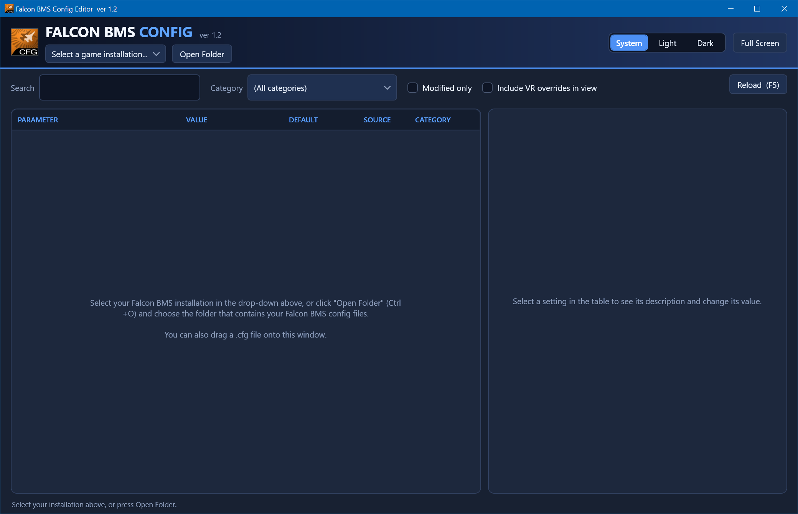
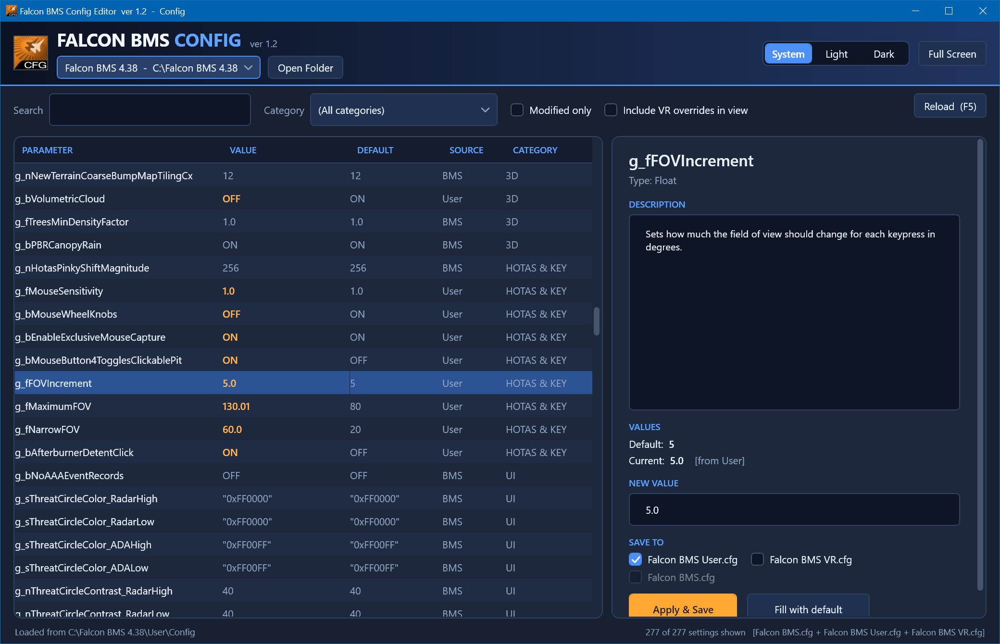

# BmsConfig
New Config tool for Falcon BMS -- replacement for the legacy F4Patch-based Config.exe

### Tenets

- Modify 'Falcon BMS User.cfg' and 'Falcon BMS VR.cfg'
- Treat 'Falcon BMS.cfg' mostly as a readonly manifest/catalog of available cfg params (except for the feature-flag params)
- Be an editor not a generator -- whitepace, comments and additional/undocumented params in User.cfg remain, unharmed
- Play nice with the Launcher -- don't add or modify below the Launcher's cut-line

### UI Prototype/Mockups




### Building

Requires the .NET SDK (8.0 or later) on Windows -- or Visual Studio 2022 -- and produces a single, dependency-free `Config.exe` targeting .NET Framework 4.8 (AnyCPU, 64-bit preferred):

```
dotnet build src/BmsConfig -c Release
```

Output: `src/BmsConfig/bin/Release/net48/Config.exe`.  Copy it into the root of a BMS install (the registry `baseDir`), next to the `User` folder.

Unit tests for the cfg parser/model run anywhere (including Linux):

```
dotnet test tests/BmsConfig.Tests
```

Every push is built on GitHub Actions (`.github/workflows/build.yml`); `Config.exe` is attached to each run as an artifact.

### Source layout

| Path | Purpose |
| --- | --- |
| `src/BmsConfig/Core/CfgDocument.cs` | Line-preserving cfg parser/editor: comments, blank lines and ordering round-trip untouched; edits replace only the value token; new lines go above the Launcher cut line. UTF-8, written without BOM. |
| `src/BmsConfig/Core/ValueConverter.cs` | Datatypes (from the `g_b`/`g_n`/`g_f`/`g_s` name prefix), `Range:[..]` and `Enum:[..]` parsing, input validation/conversion (hex ints, no float exponents/NaN/Inf, fancy-quote stripping), and the feature-flag regexes. |
| `src/BmsConfig/Core/ConfigSet.cs` | Merges `Falcon BMS.cfg` → `User.cfg` → `VR.cfg` (last writer wins), assigns categories, and writes edits back to disk immediately. |
| `src/BmsConfig/Core/BmsInstalls.cs` | Finds side-by-side installs under `HKLM\SOFTWARE\WOW6432Node\Benchmark Sims`. |
| `src/BmsConfig/MainWindow.xaml(.cs)` | The master/detail UI. |
| `src/BmsConfig/Themes/` | Dark / Light palettes, and the control styles. |
