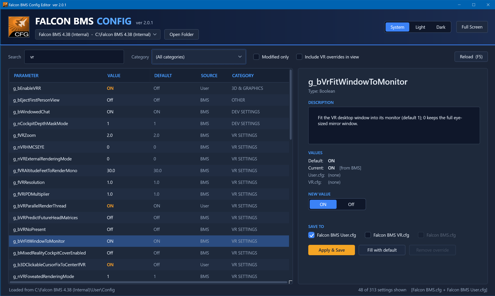

# BmsConfig
New Config tool for Falcon BMS -- replacement for the legacy F4Patch-based Config.exe

### Tenets

- Modernize look & feel
- Cover the updated set of cfg params for 4.38.x (and remove all the old dead params)
- Save user config in 'Falcon BMS User.cfg' and 'Falcon BMS VR.cfg' (not 'Falcon BMS.cfg' which is overwritten with every update)
- Treat 'Falcon BMS.cfg' as a (mostly) readonly manifest, of available cfg params (except for the feature-flag params, which are only written to the BMS.cfg)
- Be an editor not a generator -- whitepace, comments and additional/undocumented params in User.cfg must remain unharmed
- Play nice with the Launcher -- don't add or modify below the Launcher's cut-line

### UI Prototype/Mockups



### Build, Test, Run

VS 2022 -- requires .Net Framework 4.8 (as preinstalled on Win10/11) plus nuget dependencies.

Unit tests for the cfg parser/model run anywhere (including Linux):

```
dotnet test tests/BmsConfig.Tests
```

Every push is built on GitHub Actions

### Releasing

Bump `<Version>` in `src/BmsConfig/BmsConfig.csproj`, then either push a matching tag (eg. `v2.0` for version 2.0.0), or run the **Release** workflow from the Actions tab (it tags the branch as `v` + the version). The workflow (`.github/workflows/release.yml`) runs the tests, builds `Config.exe` on Windows, and publishes a GitHub release with the exe attached and auto-generated release notes.
